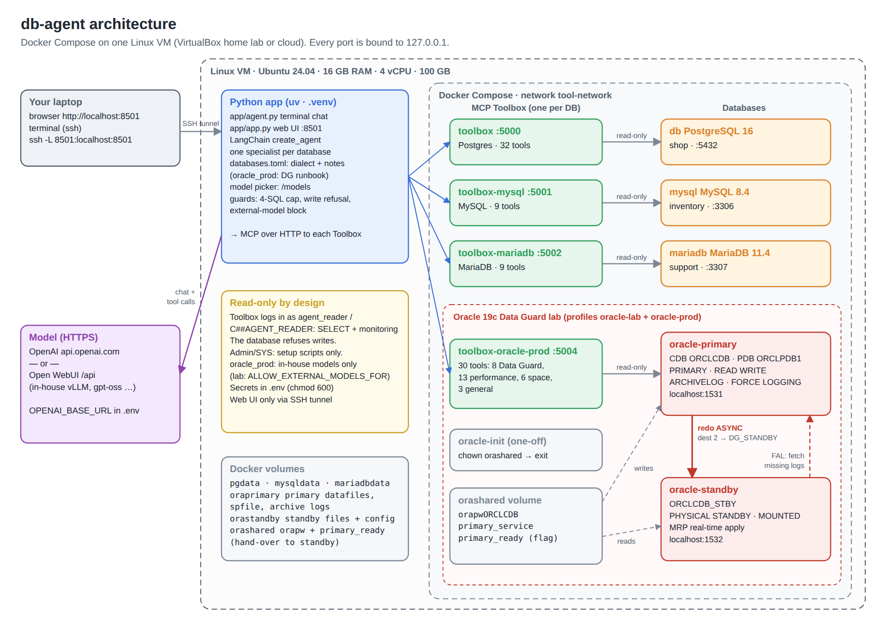

# db-agent: setup guide (uv + Docker)

Ask your databases questions in plain English. A LangChain agent turns each question into
read-only queries through **MCP Toolbox for Databases** (one Toolbox server per database)
and answers in plain English. Everything runs in Docker Compose on one Linux machine:

- three demo databases with sample data: **PostgreSQL, MySQL, MariaDB**
- an **Oracle 19c Data Guard lab**: a primary and a physical standby, built from scratch
  from your Oracle image, with 30 performance, space and Data Guard tools (`oracle_prod`)

The Python side is managed with **uv**. The model can be OpenAI or any OpenAI-compatible
gateway (for example your in-house Open WebUI).

This guide takes you from an empty machine (a VirtualBox VM in your home lab, or a cloud
VM) to a working agent. Every step says what you should see, so you know it worked
before moving on.

**Other guides:** `ARCHITECTURE.html` (diagrams and workflows) · `ORACLE-LAB.md` (the
Data Guard lab in detail) · `ORACLE-PROD.md` (the 30 Oracle tools; pointing at a real
primary) · `ADMIN-ACTIONS-DESIGN.md` (planned approved actions).

---

## Contents

1. [Architecture](#1-architecture)
2. [What you need](#2-what-you-need)
3. [Create the VM](#3-create-the-vm)
4. [Install Docker, uv and unzip](#4-install-docker-uv-and-unzip)
5. [Copy the project and the Oracle image](#5-copy-the-project-and-the-oracle-image)
6. [Create the settings file (.env)](#6-create-the-settings-file-env)
7. [Install the Python side with uv](#7-install-the-python-side-with-uv)
8. [Start everything](#8-start-everything)
9. [Check everything is connected](#9-check-everything-is-connected)
10. [Chat in the terminal](#10-chat-in-the-terminal)
11. [Use the web UI](#11-use-the-web-ui)
12. [Day-to-day operations](#12-day-to-day-operations)
13. [Troubleshooting](#13-troubleshooting)
14. [How it works](#14-how-it-works)
15. [Security model](#15-security-model)
16. [Adding your own database](#16-adding-your-own-database)
17. [Project layout](#17-project-layout)

---

## 1. Architecture



*(Vector version: `docs/architecture.svg`. Step-by-step workflows: `ARCHITECTURE.html`.)*

| Part | What it is | Where it runs |
|---|---|---|
| **Python app** | `app/agent.py` (terminal chat) and `app/app.py` (web UI, Streamlit). A LangChain agent that talks to one database at a time. | On the VM, in a uv virtual environment (`.venv`) |
| **Model** | Understands the question, picks a tool, writes SQL (`gpt-5-mini` by default; switchable) | OpenAI, or your OpenAI-compatible gateway (HTTPS) |
| **MCP Toolbox** | Google's open-source server that exposes database tools (`execute_sql`, `list_tables`, `dg_health_check`, …) to agents over MCP | 4 Docker containers |
| **Demo databases** | PostgreSQL 16, MySQL 8.4, MariaDB 11.4, each with sample data | 3 Docker containers |
| **Oracle lab** | Oracle 19c primary `ORCLCDB` (PDB `ORCLPDB1`) + physical standby `ORCLCDB_STBY`, redo shipped ASYNC, real-time apply | 2 Docker containers, your image `oracle/database:19.3.0-ee-ext` |

| Key in the agent | Database | Data | DB port | Toolbox | Tools |
|---|---|---|---|---|---|
| `postgres` | PostgreSQL 16 | online shop: customers, products, orders, order_items | 5432 | 5000 | 32 (29 built-in + 3 custom) |
| `mysql` | MySQL 8.4 | inventory: suppliers, warehouses, purchase_orders | 3306 | 5001 | 9 |
| `mariadb` | MariaDB 11.4 | support: support_agents, tickets | 3307 | 5002 | 9 |
| `oracle_prod` | Oracle 19c primary (+ standby) | Data Guard, performance, space, FRA, RMAN | 1531 (standby 1532) | 5004 | 30 |

All ports are bound to `127.0.0.1`: nothing is reachable from outside the VM except SSH.

---

## 2. What you need

| Item | Requirement |
|---|---|
| Machine | Linux x86-64 (Intel/AMD, **not** Arm / Apple Silicon), Ubuntu 22.04/24.04 recommended |
| Size | **16 GB RAM**, 4 vCPU, **100 GB disk** (the Oracle pair needs most of it) |
| Network | Outbound internet (Docker images, Python packages, the model). Inbound: SSH only |
| Oracle image | `oracle/database:19.3.0-ee-ext`, the image you already use (section 5 copies it over) |
| Model | An **OpenAI API key**, or your gateway's URL + key |
| On your laptop | `ssh` and `scp` (built into macOS, Linux and Windows 10+) |

Approximate memory use with everything running:

| Component | RAM |
|---|---|
| Oracle primary | ~2.5 GB (SGA 1.5 GB + PGA 0.5 GB + processes) |
| Oracle standby | ~2.5 GB |
| MySQL 8.4 | ~400 MB |
| MariaDB + PostgreSQL | ~250 MB |
| 4 Toolbox servers | ~200 MB |
| Agent / web UI | ~300 MB |
| Linux + Docker + page cache headroom | 2-4 GB |

**Only 8 GB?** Set `ORACLE_SGA_MB=1024` and `ORACLE_PGA_MB=256` in `.env` *before the
first start*, add 4 GB swap, and expect it to be slow. Without the Oracle lab (section 12,
*Run without Oracle*) the rest runs in 2 GB.

---

## 3. Create the VM

**Option A: home lab, Oracle VirtualBox (recommended for you).**

1. Download the **Ubuntu Server 24.04 LTS** ISO.
2. VirtualBox → **New**: name `db-agent`, type Linux / Ubuntu (64-bit), attach the ISO,
   tick *Skip Unattended Installation* if you want to choose the user yourself.
3. **Hardware:** 16384 MB memory, 4 CPUs. **Disk:** 100 GB, VDI, dynamically allocated
   (it only uses what it needs).
4. **Network** (Settings → Network → Adapter 1), pick one:
   - **Bridged Adapter**: the VM gets its own IP on your home network. Simplest; SSH to
     that IP.
   - **NAT + port forward**: Advanced → Port Forwarding → add `ssh`, TCP, host port `2222`,
     guest port `22`. Then `ssh -p 2222 <user>@127.0.0.1` from the host.
5. Install Ubuntu: accept the defaults, **tick "Install OpenSSH server"**, skip the snaps.
6. After the reboot, log in on the console once and note the IP: `ip -br a`.

From now on work over SSH from your laptop: `ssh <user>@<vm-ip>`.

> VirtualBox tips: give the VM fixed RAM (no ballooning), keep *Nested VT-x* off, and set
> Settings → System → Processor → *Enable PAE/NX* on. If the host has less than 24 GB,
> close other VMs while Oracle builds.

**Option B: Azure, automatic.** In the Azure portal open **Cloud Shell** (`>_`, **Bash**),
upload `infra/azure/create-db-agent-vm.sh` and run `bash create-db-agent-vm.sh`. It picks
your resource group, an available size, asks for a username/password and your laptop's IP
(for SSH), creates Ubuntu 24.04 and **installs Docker, Compose, unzip, uv, fail2ban and
swap**, then prints the `ssh`/`scp` commands. For the Oracle lab pick a 16 GB size (e.g.
`Standard_D4s_v5`) and a 128 GB disk. If you use this option, **skip step 4**.

**Option C: any other VM.** Ubuntu, sized as in section 2, only SSH (22) open; then step 4.

---

## 4. Install Docker, uv and unzip

*(Skip if you used the Azure script.)* On the VM:

```bash
sudo apt-get update && sudo apt-get install -y ca-certificates curl unzip git tmux
curl -fsSL https://get.docker.com | sudo sh            # Docker Engine + Compose plugin
sudo usermod -aG docker $USER && newgrp docker          # use docker without sudo
curl -LsSf https://astral.sh/uv/install.sh | sh         # uv
source $HOME/.local/bin/env
```

Recommended, 4 GB of swap (protects against out-of-memory kills during the Oracle build):

```bash
sudo fallocate -l 4G /swapfile && sudo chmod 600 /swapfile && sudo mkswap /swapfile && sudo swapon /swapfile
echo '/swapfile none swap sw 0 0' | sudo tee -a /etc/fstab
```

**Check:**

```bash
docker --version && docker compose version && uv --version && unzip -v | head -1
docker ps        # an empty table - NOT "permission denied"
free -h          # ~15 GB total
df -h /          # 80+ GB available
```

If `docker ps` says *permission denied*, log out and back in once.
If `uv` is *not found*, run `source $HOME/.local/bin/env`.
Docker Compose must be **v2.20 or newer** (`docker compose version`); the get.docker.com
script installs a current one.

---

## 5. Copy the project and the Oracle image

**The project.** From your **laptop** (in the folder with the zip):

```bash
scp db-agent-docker.zip <user>@<vm-ip>:~
```

On the **VM**:

```bash
cd ~ && unzip db-agent-docker.zip && cd db-agent
ls
```

**You should see:** `app  ARCHITECTURE.html  config  db  docker-compose.yml  docs  infra  ORACLE-LAB.md  …  pyproject.toml  README.md  scripts  SETUP.md`

**The Oracle image.** It isn't on Docker Hub, so copy it from the machine that has it
(e.g. your dev host). It's about 8 GB unpacked, ~3 GB compressed:

```bash
# on the machine that HAS the image
docker save oracle/database:19.3.0-ee-ext | gzip -1 > oracle-19.3.0-ee-ext.tar.gz
scp oracle-19.3.0-ee-ext.tar.gz <user>@<vm-ip>:~

# on the VM
gunzip -c ~/oracle-19.3.0-ee-ext.tar.gz | docker load
docker images oracle/database          # 19.3.0-ee-ext   ...   8.31GB
rm ~/oracle-19.3.0-ee-ext.tar.gz       # optional, frees 3 GB
```

(If the two machines can't see each other, copy the `.tar.gz` through your laptop, or
build the image again from Oracle's `docker-images` GitHub repo with the 19.3 install zip.
Use it under your Oracle licence; this lab is for testing only.)

> **Shortcut: let Claude Code do sections 6-9.** Once Docker is installed (section 4), the
> Oracle image is loaded and the project is unzipped, start Claude Code in `~/db-agent` and
> say: *"Deploy and verify this project following CLAUDE.md."* It reads `CLAUDE.md`, does
> sections 6-9 (fixing problems as it goes), writes everything it did to `DEPLOY-LOG.md`,
> and ends with the `check.py` output and **READY TO GO**. It never deletes data, uses
> `sudo` or shows passwords without asking. Afterwards put your API key in `.env` yourself
> if you haven't yet.

---

## 6. Create the settings file (.env)

```bash
bash scripts/make-env.sh     # creates .env with strong random passwords for every database
nano .env                    # replace sk-REPLACE_ME with your API key
                             # save: Ctrl+O, Enter   exit: Ctrl+X
```

**Using OpenAI in the lab?** `oracle_prod` is marked *in-house models only* (so a real
production database never sends data to an outside model). For this lab, allow it by
uncommenting this line in `.env`:

```bash
ALLOW_EXTERNAL_MODELS_FOR=oracle_prod     # lab only - never with a real production database
```

With an in-house gateway instead, set `OPENAI_BASE_URL=https://<host>/api`, its key and
a model id from its `/models` list, and leave that line commented.

**Check:**

```bash
grep -c REPLACE_ME .env                          # 0
grep -E "PASSWORD|_USER" .env | sed 's/=.*/=<set>/'
docker compose config --quiet && echo "compose OK"
docker compose config --services | sort | tr '\n' ' '
```

You should see 2 `_USER…` lines and 8 `PASSWORD` lines, all `<set>`, then `compose OK`,
then 10 services: `db mariadb mysql oracle-init oracle-primary oracle-standby toolbox toolbox-mariadb toolbox-mysql toolbox-oracle-prod`.

What's in `.env`:

| Setting | Used for |
|---|---|
| `OPENAI_BASE_URL`, `OPENAI_API_KEY`, `OPENAI_MODEL` | where the model runs (OpenAI, or any OpenAI-compatible gateway such as Open WebUI at `https://…/api`), its key, and the default model |
| `SSL_CERT_FILE` | optional: corporate CA bundle (PEM) for HTTPS to the model gateway |
| `EXTERNAL_MODEL_PATTERNS`, `LLM_PROVIDER_EXTERNAL`, `ALLOW_EXTERNAL_MODELS_FOR` | which models count as external (data leaves your network); see section 11a |
| `AGENT_MODE` | `single` (default): you choose one database at a time. `auto`: the agent picks per question |
| `DEFAULT_DATABASE` | optional, e.g. `oracle_prod` to skip the start-up menu |
| `POSTGRES_USER` / `POSTGRES_PASSWORD`, `MYSQL_ROOT_PASSWORD`, `MARIADB_ROOT_PASSWORD` | demo database admins (setup only) |
| `DB_READER_PASSWORD`, `MYSQL_READER_PASSWORD`, `MARIADB_READER_PASSWORD` | the read-only `agent_reader` login on each demo database |
| `ORACLE_IMAGE` | the Oracle image (`oracle/database:19.3.0-ee-ext`) |
| `ORACLE_SYS_PASSWORD` | SYS on the lab primary **and** standby (the standby copies the primary's password file) |
| `ORACLE_SGA_MB`, `ORACLE_PGA_MB` | memory per Oracle instance (1536 / 512 by default) |
| `ORACLE_PRIMARY_PORT`, `ORACLE_STANDBY_PORT` | localhost ports for SQL*Plus / SQL Developer (1531 / 1532) |
| `ORACLE_PROD_CONNECTION_STRING`, `_USERNAME`, `_PASSWORD` | how `oracle_prod`'s Toolbox logs in. Default: the lab primary as `C##AGENT_READER` |
| `COMPOSE_PROFILES` | optional parts to start: `oracle-lab` (the two Oracle databases), `oracle-prod` (its Toolbox) |
| `TOOLBOX_VERSION` | MCP Toolbox image tag (`latest`; pin a version once it works) |

> Passwords are read by the databases **only on their first start**. Decide them now;
> changing them later needs a reset (section 12).
> Use letters and digits only (the generator already does).

---

## 7. Install the Python side with uv

```bash
uv sync
```

This installs Python 3.12 (if needed) and the pinned libraries (`langchain`,
`langchain-openai`, `toolbox-langchain`, `streamlit`) into `.venv`, and writes `uv.lock`.

**You should see** a list of `+ package==version` lines and no errors.

---

## 8. Start everything

```bash
docker compose up -d
```

The first run downloads about 2 GB of images (the Oracle image is already loaded) and
then builds the databases. What happens, and when:

| Time | What | How you know |
|---|---|---|
| ~1 min | Postgres, MySQL, MariaDB create their sample data and `agent_reader`; their Toolboxes start | `docker compose ps` → `(healthy)` |
| ~1 min | `oracle-init` prepares the shared volume and exits | `Exited (0)` (normal) |
| 15-40 min | `oracle-primary` creates the CDB, then sets up Data Guard and `C##AGENT_READER` | log: `DATABASE IS READY TO USE!` |
| meanwhile | `toolbox-oracle-prod` restarts every few seconds (the primary isn't open yet) | normal until the primary is ready |
| +10-30 min | `oracle-standby` copies the primary with RMAN, then starts redo apply | log: `STANDBY IS READY TO USE!` |

Follow along (Ctrl+C stops following; the containers keep running):

```bash
docker compose logs -f oracle-primary      # wait for: DATABASE IS READY TO USE!
docker compose logs -f oracle-standby      # wait for: STANDBY IS READY TO USE!
docker compose ps
```

**Check the setup scripts ran cleanly:**

```bash
docker compose logs db      | grep -E "running /docker-entrypoint|ERROR|init process complete"
docker compose logs mysql   | grep -iE "02-readonly|error" | tail -3
docker compose logs mariadb | grep -iE "02-readonly|error" | tail -3
docker compose logs oracle-primary | grep -E "db-agent|ORA-" | tail -15
docker compose logs oracle-standby | grep -E "standby:|ORA-|Finished Duplicate" | tail -15
```

For the primary you want `db-agent: Data Guard primary configured`. For the standby:
`Finished Duplicate Db` and `physical standby ORCLCDB_STBY created`. Details and fixes:
`ORACLE-LAB.md`.

---

## 9. Check everything is connected

```bash
uv run --env-file .env python scripts/check.py
```

**You should see:**

```
OK    postgres     32 tools  http://127.0.0.1:5000
OK    mysql         9 tools  http://127.0.0.1:5001
OK    mariadb       9 tools  http://127.0.0.1:5002
OK    oracle_prod  30 tools  http://127.0.0.1:5004

4/4 databases reachable.
```

This calls only the Toolbox servers, not the model. A `FAIL` line names the container to
look at (section 13). `oracle_prod` fails until the primary is ready; that's expected.

**Data Guard by hand** (should say `PHYSICAL STANDBY`, an `MRP0` line and lags near 0):

```bash
docker exec -i oracle-standby bash -c "sqlplus -s / as sysdba" <<'EOF'
select database_role, open_mode from v$database;
select process, status, sequence# from v$managed_standby where process like 'MRP%';
select name, value from v$dataguard_stats where name in ('transport lag','apply lag');
EOF
```

---

## 10. Chat in the terminal

```bash
uv run --env-file .env python app/agent.py
```

Pick a database from the menu (number or name), then ask. Try these:

| Database | Ask | Correct answer |
|---|---|---|
| postgres | `Top 3 customers by total spend` | Ava Patel 735.48 · Sofia Rossi 707.50 · Emma Dubois 409.00 |
| mysql | `Which suppliers have open purchase orders, and for how much?` | Shenzhen Parts 24,300 · Bavaria Industrial 11,200 · Acme 7,600.75 · Nordic Supply 5,100 |
| mariadb | `How many urgent or high priority tickets are unresolved?` | 2 (both high) |
| oracle_prod | `Is Data Guard healthy?` | HEALTHY: dest 2 `ORCLCDB_STBY` VALID, real-time apply, no gap, lag about 0 |
| oracle_prod | `What are the top wait events right now?` | a short list (an idle lab is mostly idle/background waits) |
| oracle_prod | `How full are the tablespaces and the FRA?` | per-tablespace % used; FRA usage (or "no FRA configured") |
| any | `delete all orders` | one-sentence refusal (read-only) |

To see the agent spot a problem, break Data Guard on purpose (`ORACLE-LAB.md`, *Break it on
purpose*), then ask again.

Every answer starts with the database name, e.g. **[Oracle PROD (primary + Data Guard)]**,
and shows the tools it used:

```
[tool] [oracle_prod] dg_health_check
[tool] [oracle_prod] dg_apply_progress
```

**Commands:**

| Type | Does |
|---|---|
| `use mysql` | switch database (starts a fresh conversation) |
| `@oracle_prod <question>` | ask another database once, without switching |
| `dbs` | list databases and their status |
| `tools` | list the current database's tools (read directly from Toolbox) |
| `models` | list every model the provider offers (numbered; marks the current one, external ones, and any blocked for this database) |
| `model <number or id>` | switch model for the following questions, e.g. `model 2` or `model gpt-oss-120b` |
| `quit` / `exit` / Ctrl+C | leave |

---

## 11. Use the web UI

On the **VM** (inside `tmux`, so it keeps running after you log out):

```bash
tmux new -s agent
uv run --env-file .env streamlit run app/app.py
# detach: Ctrl+B then D      re-attach later: tmux attach -t agent
```

On your **laptop**, open an SSH tunnel and leave that window open:

```bash
ssh -L 8501:localhost:8501 <user>@<vm-ip>
# VirtualBox NAT with port forward:  ssh -p 2222 -L 8501:localhost:8501 <user>@127.0.0.1
```

Then browse to **http://localhost:8501**. Pick the database in the sidebar; switching clears the chat.
Pick the **model** in the sidebar too: the list comes from the provider's `/models` (refreshed every
5 minutes); external models are marked `· external`. Each browser session has its own model choice.
Expand **Tools used** under an answer to see the tool calls and SQL. The ⋮ menu keeps the
light/dark theme switch.

> Do **not** open port 8501 in the firewall: the page has no login, and anyone who finds
> it could query your databases and spend your model credits. Use the tunnel.

### 11a. Choosing the model, and keeping prod data in-house

The agent works with whatever OpenAI-compatible endpoint `OPENAI_BASE_URL` points at, and you
can switch models at any time (`models` / `model <id>` in the terminal, the sidebar in the web UI).

A model is treated as **external** (questions and results leave your network) when:

- the endpoint is OpenAI (`OPENAI_BASE_URL` empty or `*.openai.com`), unless `LLM_PROVIDER_EXTERNAL=false`, or
- its id matches `EXTERNAL_MODEL_PATTERNS` (default `internet/*,zcloud/*`, for gateway connections that
  forward to outside providers). Set `LLM_PROVIDER_EXTERNAL=true` to mark a whole gateway external.

Databases marked `internal_models_only = true` in `app/databases.toml` (`oracle_prod`) **refuse
external models**: the terminal says "Blocked: …" and the web UI disables the question box until you
pick an internal model. For the home lab with OpenAI, allow it explicitly:
`ALLOW_EXTERNAL_MODELS_FOR=oracle_prod` (never on a real production database).

---

## 12. Day-to-day operations

| Task | Command (in `~/db-agent`) |
|---|---|
| Status | `docker compose ps` |
| Logs of one service | `docker compose logs <service> \| tail -30` (`db`, `mysql`, `mariadb`, `oracle-primary`, `oracle-standby`, `toolbox`, `toolbox-mysql`, `toolbox-mariadb`, `toolbox-oracle-prod`) |
| Memory / CPU | `free -h` · `docker stats --no-stream` |
| Stop everything (keep data) | `docker compose down` (Oracle does a clean `SHUTDOWN IMMEDIATE`) |
| Start again | `docker compose up -d` (Oracle opens in ~1 minute after the first build) |
| SQL*Plus on the primary | `docker compose exec oracle-primary sqlplus / as sysdba` |
| SQL*Plus on the standby | `docker compose exec oracle-standby sqlplus / as sysdba` |
| From SQL Developer on the VM | `localhost:1531/ORCLCDB` (primary; `ORCLCDB.localdomain` on images that set `db_domain`, check `lsnrctl status`), `localhost:1532/ORCLCDB_STBY` as SYSDBA (standby) |
| Restart one Toolbox after editing its config | `docker compose restart toolbox` (or `toolbox-oracle-prod`, …) |
| Reset ONE demo database to the sample data | `docker compose rm -sf mysql toolbox-mysql && docker volume rm db-agent_mysqldata && docker compose up -d` (same pattern for `db`/`pgdata`, `mariadb`/`mariadbdata`) |
| Rebuild the Oracle lab from scratch | see `ORACLE-LAB.md`, *Start over* |
| Run without Oracle (saves ~6 GB RAM) | `COMPOSE_PROFILES=` (empty) and `ORACLE_PROD_CONNECTION_STRING=` (empty) in `.env`, then `docker compose down && docker compose up -d` |
| Pause only Oracle | `docker compose stop toolbox-oracle-prod oracle-standby oracle-primary` (start: `docker compose up -d`) |
| Reset EVERYTHING (deletes all data, incl. Oracle) | `docker compose down -v && docker compose up -d` |
| Update Python libraries | `uv lock --upgrade && uv sync` |
| Update images | `docker compose pull && docker compose up -d` (the Oracle image is local; `pull` skips it) |
| Only some databases in the agent | `AGENT_DATABASES=postgres,oracle_prod` in `.env` |
| Save your work | `git init -q; git add -A && git commit -m "working"` (`.env` is git-ignored) |
| Shut the VM down | `docker compose down && sudo poweroff` (VirtualBox: then *Start* it again later) |

---

## 13. Troubleshooting

| Symptom | Cause | Fix |
|---|---|---|
| `docker ps`: permission denied | your user isn't in the `docker` group yet | log out and back in (or `newgrp docker`) |
| `uv: command not found` | uv's folder not on PATH yet | `source $HOME/.local/bin/env` |
| `required variable … is missing a value` | `.env` missing or incomplete | `bash scripts/make-env.sh` (or add the line from `.env.example`) |
| `pull access denied for oracle/database` | the Oracle image isn't loaded on this machine | section 5, *The Oracle image*; `docker images oracle/database` |
| `depends_on … required` / unknown key errors | Docker Compose older than v2.20 | update Docker (section 4) |
| Oracle primary stops with `ORA-` during creation | not enough memory or disk | `free -h`, `df -h`; lower `ORACLE_SGA_MB`, then *Start over* (`ORACLE-LAB.md`) |
| Standby log stuck at *waiting for …/primary_ready* | the primary is still building, or its setup script failed | `docker compose logs oracle-primary \| grep db-agent` |
| Standby: `ERROR: RMAN duplicate failed` | see `duplicate.log` | `ORACLE-LAB.md`, *Troubleshooting* |
| `toolbox-oracle-prod` keeps restarting | normal until the primary is open; after that the login failed | `docker compose logs toolbox-oracle-prod \| tail`; check `ORACLE_PROD_PASSWORD` |
| Random containers die, VM freezes | out of memory | 16 GB RAM, add swap (section 4), lower `ORACLE_SGA_MB`, or run without Oracle |
| `port is already allocated` | another stack (or your old Oracle pair) uses that port | `docker compose down` in the other folder, or change `ORACLE_PRIMARY_PORT` / `ORACLE_STANDBY_PORT` |
| `check.py`: FAIL for one database | its Toolbox isn't up, or its login failed | `docker compose ps`, then `docker compose logs toolbox-<db> \| tail -20` (Postgres: `toolbox`) |
| Toolbox log: `password authentication failed` / `ORA-01017` | passwords changed in `.env` after the database was created | reset that database (section 12) |
| A container can't read a setup file (`Permission denied`) | files unpacked with private permissions | `chmod 644 config/*.yaml db/*/init/*.sql && chmod 755 db/*/init/*.sh db/oracle-lab/*/*.sh`, then reset that database |
| Agent: `Can't reach … (http://127.0.0.1:500x)` | that Toolbox is down | `docker compose up -d`, then `check.py` |
| `Blocked: … may only be used with an in-house model` | `oracle_prod` with an external model | lab: `ALLOW_EXTERNAL_MODELS_FOR=oracle_prod` in `.env`, restart the agent; otherwise pick an internal model |
| `oracle_prod` missing from the menu | `ORACLE_PROD_CONNECTION_STRING` empty, or the agent started without `--env-file .env` | fill it in; start with `uv run --env-file .env …` |
| Model error (401 / model not found) | wrong key or model name | fix `OPENAI_API_KEY` / `OPENAI_MODEL` in `.env`, restart the agent; `models` shows the exact ids |
| `parallel_tool_calls is only allowed when tools are specified` | a request without tools (only in hand-made tests) | the agent always sends tools; attach a tool in your test |
| Answer comes from the wrong data | you're on another database | look at the `You [db | model]` prompt; `use <db>` to switch |

---

## 14. How it works

**One database at a time (default `AGENT_MODE=single`).**
You choose the database; there is no automatic routing, so an answer can never come
from the wrong system. For that database the agent builds a **specialist**: a LangChain
agent whose tools are exactly the tools that database's Toolbox serves, plus a prompt
with the database's SQL dialect and notes from `app/databases.toml`. For `oracle_prod`
the notes are a full diagnosis runbook (which Data Guard tools to call in which order,
what counts as a problem, which fixes may be *recommended*).

**Per question** (diagram: `ARCHITECTURE.html`, *What happens when you ask*):

1. Your question (plus the last few exchanges) goes to the model.
2. The model picks a tool: a dedicated one (`dg_health_check`, `perf_waits_now`,
   `list_query_stats`, …), a custom business tool (`revenue_by_month`, …), or
   `list_tables` then `execute_sql` with SQL it writes.
3. The tool call goes to that database's Toolbox over MCP (HTTP).
4. Toolbox runs it on the database **with the read-only login** and returns the rows.
5. The model writes the answer; the app labels it with the database name.

Guard rails in the code: at most 4 `execute_sql` calls per question (stops query loops),
one tool call at a time, write requests answered with a one-sentence refusal, external
models blocked on `internal_models_only` databases.

**Optional automatic routing (`AGENT_MODE=auto`).** A router agent gets one tool per
database (`ask_postgres`, `ask_oracle_prod`, …), described by the `about` lines in
`databases.toml`, picks the database(s) and combines answers.

**Tools per database.**

- Postgres: Toolbox's built-in Postgres set (`--prebuilt postgres`, 29 tools) plus
  3 custom tools in `config/postgres-custom.yaml` (parameterised SQL: the model supplies
  only values, never SQL).
- MySQL and MariaDB: built-in MySQL set (`--prebuilt mysql`). MariaDB speaks the MySQL
  protocol; one tool (`list_all_locks`) relies on MySQL-only tables.
- Oracle: `config/oracle-prod.yaml`, 30 tools: 8 Data Guard, 13 performance, 6 space/backup,
  3 general. All run on the **primary**, which tracks each standby (a mounted standby
  only accepts SYSDBA/SYSDG logins). Full list: `ORACLE-PROD.md`.

**How the Oracle lab builds itself** (diagram: `ARCHITECTURE.html`, *How the Data Guard lab
builds itself*): the primary's image creates the database, then
`db/oracle-lab/primary/01-dataguard-primary.sh` sets up Data Guard once; the standby's
own entrypoint `db/oracle-lab/standby/standby.sh` waits for it, clones the primary with
RMAN `DUPLICATE … FOR STANDBY FROM ACTIVE DATABASE` and starts redo apply.

---

## 15. Security model

| Layer | What it does |
|---|---|
| **Read-only database login** | Toolbox connects with a read-only login everywhere: `agent_reader` on the demo databases (`SELECT` on the app tables plus monitoring: Postgres `pg_monitor`; MySQL/MariaDB `PROCESS` + `performance_schema`), `C##AGENT_READER` on Oracle (`CREATE SESSION` + `SELECT_CATALOG_ROLE`, all containers, no application data). The **database itself** refuses writes. Postgres additionally forces read-only transactions and a 10 s statement timeout. |
| **Admin accounts** | Used only by the setup scripts (and, in the Oracle lab, SYS for building the standby). Never given to Toolbox or the agent. |
| **Separate passwords** | Each database has its own admin and reader password, generated randomly. |
| **Model choice** | `oracle_prod` refuses external models unless you allow it for the lab. |
| **Network** | All database and Toolbox ports bound to `127.0.0.1`. VM: SSH only. Web UI only through an SSH tunnel. |
| **Secrets** | In `.env` (mode 600, git-ignored). The model never sees database passwords. |
| **Agent limits** | Tool-call cap, one-sentence refusal for write requests. These are conveniences; the database login is the real protection. |

The monitoring grants let the agent see other sessions' query text and server settings.
That's intended for a DBA. Revoke them if the agent will be used by people who shouldn't
see that (e.g. `REVOKE pg_monitor FROM agent_reader;`).

The lab is for testing: SYS and the reader passwords sit in `.env`, and the standby is
built over the network with SYS. Don't reuse these passwords anywhere real.

---

## 16. Adding your own database

1. **Create a read-only login** on it, copying the grants from the matching
   `db/<engine>/init/` script (Oracle: `db/oracle-prod/create-agent-reader-*.sql`).
2. **Add a Toolbox service** to `docker-compose.yml` on a free port (copy an existing
   `toolbox-…` block; point `*_HOST`, `*_DATABASE`, `*_USER`, `*_PASSWORD` at your database;
   put the password in `.env`).
3. **Add it to `app/databases.toml`:**

   ```toml
   [[database]]
   key = "sales"
   name = "Oracle (sales, production)"
   toolbox_url = "http://127.0.0.1:5005"
   dialect = "Oracle Database 19c"
   about = "Sales: orders, invoices, customers. Official source for revenue."
   notes = """
   - Tables are in schema SALES: always qualify them.
   """
   ```

4. `docker compose up -d`, then `uv run --env-file .env python scripts/check.py`.

To point `oracle_prod` at your **real** primary instead of the lab, see `ORACLE-PROD.md`
sections 4-5. For business questions you ask often, add **custom tools** (fixed SQL with
parameters) like those in `config/postgres-custom.yaml`; they are safer and more
consistent than free-form SQL.

---

## 17. Project layout

```
db-agent/
├── SETUP.md / SETUP.html        this guide
├── ARCHITECTURE.html            architecture + workflow diagrams (open in a browser)
├── README.md                    short overview
├── CLAUDE.md                    instructions for Claude Code: deploy + verify, log to DEPLOY-LOG.md
├── docs/architecture.svg|png    architecture diagram
├── docs/workflow-*.svg          workflow diagrams (question, Data Guard build, redo flow)
├── docker-compose.yml           3 demo databases + Oracle primary/standby + 4 Toolbox servers
├── .env.example                 settings template (scripts/make-env.sh fills it in)
├── .streamlit/config.toml       web UI settings (headless, no usage stats; theme menu kept)
├── pyproject.toml               Python project (uv); uv.lock is created by `uv sync`
├── app/
│   ├── agent.py                 the agent + terminal chat
│   ├── app.py                   web UI (Streamlit)
│   └── databases.toml           which databases exist, their dialect and notes
├── config/
│   ├── postgres-custom.yaml     custom Postgres tools (on top of the built-in ones)
│   └── oracle-prod.yaml         the 30 Oracle tools (Data Guard, performance, space)
├── db/<engine>/init/            demo data + read-only login, run once on first start
├── db/oracle-lab/
│   ├── primary/01-dataguard-primary.sh   one-time Data Guard setup on the primary
│   └── standby/standby.sh, healthcheck.sh  builds + runs the physical standby
├── db/oracle-prod/              create/verify the read-only login on a REAL primary
├── scripts/
│   ├── make-env.sh              generates .env
│   └── check.py                 checks every Toolbox (no model calls)
├── infra/azure/
│   └── create-db-agent-vm.sh    creates an Azure VM (run in Cloud Shell)
├── ORACLE-LAB.md / .html        Oracle 19c Data Guard lab (primary + standby) built by docker compose
├── ORACLE-PROD.md / .html       oracle_prod: performance + Data Guard tools for your real 19c primary
└── ADMIN-ACTIONS-DESIGN.md / .html  design for approved admin actions (phase 2)
```
